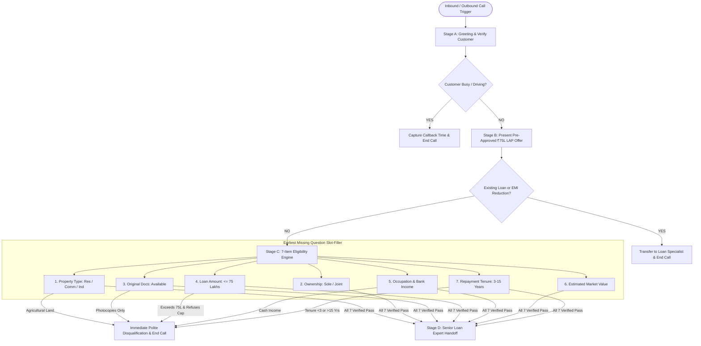

# Home Credit AI Voice Agent: Loan Against Property (LAP) Qualification

[](https://opensource.org/licenses/MIT)
[](https://www.python.org/downloads/)
[](https://react.dev/)
[](https://fastapi.tiangolo.com/)

> **SalesAgents AI - AI Intern (Prompt Engineer) Hiring Assignment Solution**  
> An enterprise-grade, conversational voice agent designed for **Home Credit** to conduct outbound preliminary qualification calls for a pre-approved Loan Against Property (LAP) offer up to ₹75,00,000.

---

## 🌟 Key Highlights & Capabilities

* **Dynamic Slot-Filling Memory**: Extracts compound utterances out-of-order without re-asking answered questions (implements the *First Missing Question* algorithm).
* **Immediate Disqualification Gates**: Halts calls instantly upon detecting ineligible criteria (Agricultural land, Cash income, Missing original documents, Tenure outside 3–15 years).
* **Dedicated Transfer Switch**: Recognizes existing-loan balance transfers or EMI-reduction requests and routes them to human loan-transfer specialists.
* **Loan Cap Consent Loop**: Tactfully negotiates loan amounts > ₹75 Lakhs by presenting the ₹75 Lakh cap before qualifying.
* **Real-Time Voice Simulation**: Full browser microphone input (Web Speech STT) + natural voice response (TTS) + live visual slot tracker.
* **10 Pre-Configured Test Scenarios**: 1-click verification of all edge cases and happy path flows.

---

## 🏗️ Architecture & Conversation State Machine



---

## 📋 The 7 Eligibility Checklist Parameters

| # | Parameter | Eligible Values | Disqualification / Boundary Rule |
| :---: | :--- | :--- | :--- |
| **1** | **Property Type** | Residential, Commercial, Industrial | **Agricultural land is immediately disqualified.** |
| **2** | **Ownership Status** | Sole ownership or Joint ownership | Both are eligible. Joint ownership is fully supported. |
| **3** | **Original Documents** | Original property documents available | Only photocopies or missing originals = **disqualified**. |
| **4** | **Loan Amount** | Up to ₹75,00,000 (75 Lakhs) | If > 75L, offers ₹75L maximum cap. Disqualifies only if customer refuses cap. |
| **5** | **Occupation & Mode** | Salaried or Self-Employed via Bank | **Cash income is strictly disqualified.** Payout must be in a bank account. |
| **6** | **Market Value** | Any customer estimate | Captured without arbitrary cutoffs (as per spec). |
| **7** | **Repayment Tenure** | 3 to 15 years (inclusive) | Repayment period $<3$ years or $>15$ years = **disqualified**. |

---

## 🚀 Quick Start Guide

### 1. Prerequisites
- **Node.js**: v18+ (Node 24 recommended)
- **Python**: 3.10+

### 2. Run the Interactive Voice Web App
```bash
# Navigate to the frontend directory
cd frontend

# Install dependencies
npm install

# Start the local development server
npm run dev
```
Open [http://localhost:5173](http://localhost:5173) in your browser. You can click **Start Call** to speak through your microphone or run any of the 10 automated test scenarios!

### 3. Run the Python Backend Engine
```bash
# In the project root, run unit tests
python run_tests.py
```
To run the FastAPI server:
```bash
pip install -r backend/requirements.txt
uvicorn backend.main:app --reload --port 8000
```

---

## 🧪 Test Suite & Edge Case Scenarios

| Test ID | Scenario | Highlights | Expected Result |
| :--- | :--- | :--- | :--- |
| **TC-01** | **Happy Path** | Residential, Sole, Originals OK, ₹50L, Salaried (Bank), 1.2 Cr, 10 Yrs | **Qualified -> Senior Loan Expert Handoff** |
| **TC-02** | **Agricultural Land** | Farmland / Agricultural property mentioned | **Immediate Disqualification at Item 1** |
| **TC-03** | **Cash Income** | Self-employed taking earnings in cash | **Immediate Disqualification at Item 5** |
| **TC-04** | **Photocopies Only** | Original title deeds misplaced | **Immediate Disqualification at Item 3** |
| **TC-05** | **Tenure < 3 Years** | Requested repayment in 2 years | **Immediate Disqualification at Item 7** |
| **TC-06** | **Loan > ₹75L Capped** | Requested ₹90L; accepted ₹75L limit | **Qualified at ₹75L Cap -> Handoff** |
| **TC-07** | **Existing Loan Switch** | Running loan on property with another bank | **Transfer to Loan Transfer Specialist** |
| **TC-08** | **EMI Reduction Switch**| Seeks to lower current mortgage EMI | **Transfer to Loan Transfer Specialist** |
| **TC-09** | **Compound Slot-Filling**| 3 data points given in 1 sentence | **Slots Extracted Correctly; No Re-asking** |
| **TC-10** | **Busy Customer** | Customer driving or in a meeting | **Callback Scheduled; Pitch Halted** |

---

## 📁 Repository Structure

```
├── backend/
│   ├── agent.py            # Dialogue generator & variable orchestrator
│   ├── main.py             # FastAPI REST endpoints & Retell webhook
│   ├── requirements.txt    # Python dependencies
│   ├── scenarios_data.py   # Test scenario definitions
│   └── state_machine.py    # 7-slot state machine & eligibility rules
├── frontend/
│   ├── src/
│   │   ├── App.jsx         # Interactive React voice call interface
│   │   ├── index.css       # Responsive dark-theme styling
│   │   ├── main.jsx        # React root
│   │   ├── scenariosData.js# Client test scenarios
│   │   └── stateEngine.js  # Client-side slot-filling engine
│   ├── package.json
│   └── vite.config.js
├── tests/
│   └── test_engine.py      # Automated Python unit test suite
├── run_tests.py            # Standalone zero-dependency test runner
├── system_prompt.md        # Production System Prompt for Retell AI / Bolna
├── test_scenarios.md       # Dialogue scripts & evaluation matrix
├── submission_guide.md     # Step-by-step Retell deployment & call recording guide
├── submission_report.md    # Formal submission report template
└── README.md               # Master documentation
```

---

## 📄 License
This project is licensed under the MIT License - see the LICENSE file for details.
